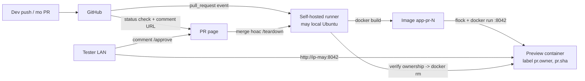

# IDEAL — Local PR Preview Pipeline

> Tài liệu thiết kế, chưa triển khai. Ngày: 2026-11-09.

## 1. Bài toán

Cần một "mini pipeline" chạy hoàn toàn trên máy local Ubuntu phục vụ vòng
dev → test → merge:

- Dev mở/cập nhật PR trên GitHub → CI runner trên máy local build Docker image
  → deploy 1 preview container trên máy local.
- Tester (cùng LAN) mở URL preview, test, comment/approve trên PR.
- Dev có thể trigger lại bằng comment (`/deploy`, `/teardown`).
- Toàn bộ hạ tầng dựng lại được trên máy mới bằng một script, phục vụ việc hay
  đổi/bán máy.

Ba stack cần hỗ trợ: **Go, .NET, Next.js** — tất cả build qua Dockerfile.

## 2. Quyết định kiến trúc

| Quyết định | Chọn | Loại bỏ | Lý do |
|---|---|---|---|
| Git hosting | GitHub (private) | Forgejo/Gitea self-host | PR, comment trigger, merge có sẵn; zero state phải backup |
| CI | GitHub Actions + self-hosted runner | Forgejo Actions, Woodpecker, Jenkins | Runner chỉ là daemon nối outbound tới GitHub; không cần public IP |
| Preview runtime | `docker run`/`compose` trực tiếp | Dokploy, Traefik, domain, HTTPS | 1 slot preview trong LAN không cần control plane |
| Build | Dockerfile multi-stage | Toolchain native (Go SDK/.NET SDK/Node cài trên host) | Máy mới chỉ cần Docker; toolchain đóng gói trong image |
| Slot preview | **1 slot, port cố định** | port-per-PR, multi-preview | User xác nhận 1 preview/lần; đơn giản hóa routing |
| Serialize slot | `flock` trên host + label ownership | Dựa vào GitHub `concurrency` | GH concurrency chỉ scope per-repo; 3 repo dùng chung slot cần lock host |

## 3. Kiến trúc tổng thể



Thành phần trên máy local:

- `actions-runner` systemd service (outbound HTTPS tới GitHub).
- `devbox/` repo: bootstrap, scripts, compose mẫu, docs.
- Preview container: tên `preview-app`, port host `8042`, labels
  `pr.owner=<owner/repo>#<pr>`, `pr.sha=<sha>`.

## 4. Quy trình vận hành

1. **PR opened/synchronize** → workflow `preview.yml`: build image →
   `deploy.sh` (flock → xem ai đang chiếm slot → ghi đè + comment cảnh báo lên
   PR cũ nếu có) → comment URL preview lên PR.
2. **Tester** truy cập `http://<lan-ip>:8042`, comment kết quả trên PR.
3. **Comment trigger** (`issue_comment` trên PR):
   - `/deploy` → rebuild + redeploy.
   - `/teardown` → xóa preview **chỉ khi** label `pr.owner` khớp PR gọi lệnh;
     nếu không khớp → comment "slot đang bị chiếm bởi `<owner>`".
4. **Merge/close** → teardown tự động với cùng rule ownership.
5. Push commit mới (`synchronize`) → rebuild + redeploy tự động.

## 5. Quy tắc slot chung (1 preview)

- Mọi mutation lên slot bọc trong `flock /tmp/preview-slot.lock` — serialize
  giữa các job từ các repo khác nhau trên cùng host.
- Container luôn mang label `pr.owner` và `pr.sha`; teardown/deploy phải đọc
  label trước khi động vào.
- Deploy ghi đè được phép nhưng phải comment cảnh báo lên PR cũ.
- GitHub `concurrency: group: preview-${{ github.event.number }}` vẫn giữ per
  repo để tránh build chồng trong một PR; nó **không** thay thế flock.

## 6. Cấu trúc repo `devbox/`

```
devbox/
├── bootstrap.sh            # cai Docker + runner + dang ky service
├── .env.example            # RUNNER_TOKEN, LAN_IP, PREVIEW_PORT
├── dockerfiles/
│   ├── go.Dockerfile       # multi-stage: golang:alpine build -> binary
│   ├── dotnet.Dockerfile   # sdk build -> aspnet runtime
│   └── nextjs.Dockerfile   # node build -> standalone output
├── scripts/
│   ├── deploy.sh           # flock -> takeover -> run labeled container
│   ├── teardown.sh         # flock -> verify owner -> rm
│   └── backup.sh           # backup .env + khong co gi khac
├── compose.preview.yml     # preview + optional DB service
└── .github/workflows/
    └── preview.yml         # mau de copy sang repo app
```

Workflow mẫu trong repo app chỉ cần: checkout → build theo Dockerfile của
stack → `scripts/deploy.sh` (runner label `self-hosted`).

## 7. Chuyển máy / bán máy

**Dựng máy mới (~5 phút):**

```bash
curl -fsSL https://get.docker.com | sh
git clone <devbox-repo> ~/devbox && cd ~/devbox
cp .env.example .env  # dien RUNNER_TOKEN lay tu GitHub Settings > Actions > Runners
./bootstrap.sh        # cai runner + systemd service + pull base images
```

State duy nhất cần mang theo: `.env` (giữ trong password manager, gitignored).
Code đã ở GitHub — không cần backup volume git server.

**Trước khi bán máy — trình tự bắt buộc:**

1. Verify backup/restore: test bung `.env` + `bootstrap.sh` trên máy/VM sạch.
2. Revoke credentials: runner token (GitHub Settings), SSH keys trên GitHub,
   registry auth, mọi token trong `.env` và shell history.
3. Secure erase / factory reset toàn ổ đĩa. Xóa `~/devbox` **không** đủ:
   named volumes ở `/var/lib/docker/volumes`, build cache, SSH keys, shell
   history, browser data đều còn lại.

## 8. Ràng buộc và giới hạn đã chốt

- Repo app: private trên GitHub. Runner self-hosted chỉ chạy workflow từ
  collaborator tin cậy — bất kỳ ai push được workflow là chạy code trên máy.
- Preview chết khi máy local tắt — tester phụ thuộc máy dev online.
- 1 preview/lần; PR thứ hai ghi đè hoặc đợi. Điểm nâng cấp đầu tiên khi team
  tăng: port-per-PR + reverse proxy (lúc đó mới cân nhắc Traefik/Dokploy).
- Không HTTPS/domain — LAN nội bộ http.
- Không registry — build → run local trực tiếp. Thêm GHCR khi cần deploy ra
  ngoài (VPS production).

## 9. Non-goals

- Git server self-hosted, CI UI riêng, observability stack.
- Production deploy (đây là vòng dev-test; production là quyết định riêng).
- Multi-preview song song, preview cho tester ngoài LAN.

## 10. Success criteria

- Mở PR → URL preview truy cập được từ LAN trong < 5 phút (đo bằng timestamp
  comment trên PR).
- `/teardown` của PR-A không xóa được preview của PR-B (verify bằng label).
- `bootstrap.sh` trên máy sạch → runner online, chạy được workflow mẫu không
  sửa tay.
- Workflow giống nhau chạy được cho cả 3 stack (chỉ đổi Dockerfile + port
  nội bộ app).
